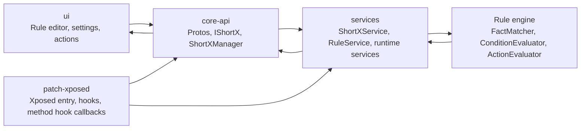

# Cross-Module Architecture Map

## Purpose

This document explains how the main ShortX layers connect at runtime, focusing on:

- `ui`
- `core-api`
- `services`
- `patch-xposed`

It is not a file-by-file inventory. It is a system map for understanding how configuration, IPC, rule execution, and Xposed callbacks fit together.

## The Short Version

ShortX is built as a layered automation system:

1. `ui` lets the user create and manage rules, direct actions, toggles, settings, and method hooks.
2. `core-api` defines the shared protobuf models, AIDL contracts, and the `ShortXManager` client wrapper.
3. `services` is the real runtime engine that stores automation state, publishes facts, evaluates conditions, and executes actions.
4. `patch-xposed` injects ShortX into system and app processes through the LSPosed API 101 runtime, observes framework behavior, and feeds hook-driven events back into `services`.

## Layer Responsibilities

### `ui`

Owns:

- feature screens
- rule and direct-action editors
- method-hook configuration UI
- settings and diagnostics UI
- user-triggered operations via `ShortXManager`

Main role in architecture:

- translate user intent into protobuf models and service calls

Representative entry points:

- `ui/src/main/java/tornaco/apps/shortx/ui/EntryPoint.kt`
- `ui/src/main/java/tornaco/apps/shortx/ui/main/`
- method-hook selector flows under `ui/.../addrule/fact/selector/`

### `core-api`

Owns:

- `IShortX.aidl`
- `ShortXManager`
- shared protobuf models
- observer and listener interfaces

Main role in architecture:

- define the contract between clients and the runtime service

Representative entry points:

- `core-api/src/main/java/tornaco/apps/shortx/core/IShortX.aidl`
- `core-api/src/main/java/tornaco/apps/shortx/core/ShortXManager.kt`
- `core-api/src/main/proto/shortx/`

### `services`

Owns:

- `ShortXService`
- `ShortXContext`
- `RuleService`
- fact publication and filtering
- condition evaluation
- action evaluation
- runtime subsystems such as notifications, overlays, input, network, media, and automation

Main role in architecture:

- run the automation engine and expose it through the binder service

Representative entry points:

- `services/src/main/java/tornaco/apps/shortx/services/ShortXService.kt`
- `services/src/main/java/tornaco/apps/shortx/services/ShortXContext.kt`
- `services/src/main/java/tornaco/apps/shortx/services/rule/RuleService.kt`

### `patch-xposed`

Owns:

- LSPosed API 101 module entry and hook dispatch
- hook registration in system server and app processes
- method-hook installation from rule definitions
- SystemUI-specific hook integrations

Main role in architecture:

- observe and intercept behavior outside the main app process, then bridge those events back into ShortX runtime

Representative entry points:

- `patch-xposed/patch-main/.../ShortXLSPosedHookEntry.kt`
- `patch-xposed/patch-main/.../HookStub2.kt`
- `patch-xposed/patch-common/.../CustomHookUtil.kt`

## Main Runtime Connections

### A. UI -> `core-api` -> `services`

This is the normal app-driven path.

Flow:

1. user edits rules, actions, or settings in `ui`
2. `ui` builds protobuf models defined in `core-api`
3. `ui` calls `ShortXManager`
4. `ShortXManager` invokes `IShortX` binder methods
5. `ShortXService` handles the request inside `services`
6. `RuleService` and other runtime services store state or execute work

Typical examples:

- add or update a rule
- execute a direct action
- register observers
- fetch evaluation records
- toggle runtime features

Key bridge:

- `ShortXManager` is the primary client façade over `IShortX`

## B. `services` internal runtime execution

Once a request or event reaches `services`, the main flow is:

1. `ShortXService` exposes binder APIs and owns `ShortXContext`
2. `ShortXContext` provides access to subsystem services
3. `RuleService` acts as the automation coordinator
4. facts enter through `publishFact(...)`
5. `DefaultRuleEngine` evaluates rules and direct-action quit flows
6. `ConditionEvaluatorImpl` checks conditions
7. `ActionEvaluatorImpl` dispatches actions to actor implementations

This is the core execution path regardless of whether the original event came from UI, system services, or Xposed callbacks.

### C. `patch-xposed` -> `core-api` / `services`

This is the injected-process path.

Flow:

1. Xposed or LSPosed loads `patch-xposed` entry code
2. `HookStub2` chooses system-server, package-loaded, or init-zygote hook flow
3. hook modules observe framework or app behavior
4. for method hooks, `CustomHookUtil.installHookForRules(...)` scans rule facts and installs live hooks
5. when a hook fires, the Xposed layer extracts runtime values from `MethodHookParam`
6. the hook callback either:
   - publishes directly into `services` if running inside system server, or
   - calls back through `ShortXManager` / `IShortX` if running in an app process
7. `services` receives the event as a normal fact and runs the standard rule engine

This is the most important architectural idea in the project: Xposed is not the automation engine. Xposed is an event and control source that feeds the same runtime engine in `services`.

## Data Shapes Shared Across Layers

These layers stay connected because they share the same data model from `core-api`.

Important shared model families:

- rules
- direct actions
- facts
- conditions
- toggles
- evaluate context
- context variables and local variables

Because all layers use the same protobuf definitions, the same `MethodHook`, `NotificationPosted`, or `Rule` model can move through:

- UI editing
- binder transport
- runtime matching
- Xposed callback publication

## i18n Across Layers

Internationalization is one of the smaller but important cross-module connections.

The split is:

- Android resources choose the locale name through `ui_i18n_name`
- JSON assets under `ui/src/main/assets/i18n/` store the actual translation content
- `core-api` defines the shared `I18N` interface
- `ui` and `services` each provide their own cache-backed implementation

This allows:

- Compose screens in `ui` to use translated strings through `LocalI18N`
- service-side dialogs, notifications, and overlays in `services` to use the same translation keys

So i18n is not purely a UI concern. It crosses module boundaries because runtime services also need translated user-facing text.

For the full i18n design, see:

- `architecture/i18n-architecture.md`

## Observer And Feedback Paths

The architecture is not one-way. `services` also pushes information back upward.

Examples:

- rule observers
- direct-action observers
- toggle observers
- job status listeners
- action evaluation listeners
- condition and fact history queries

This gives `ui` a live view of what the runtime is doing.

## Practical Architecture View

### If you are changing UI behavior

Start in `ui`, then follow the path into `ShortXManager`, then into the relevant `IShortX` binder method and `ShortXService` implementation.

### If you are changing rule execution

Start in `services`, especially:

- `RuleService`
- `DefaultRuleEngine`
- `ConditionEvaluatorImpl`
- `ActionEvaluatorImpl`

### If you are changing hook-driven automation

Start in `patch-xposed`, then trace how the hook callback is bridged into `services`.

### If you are changing shared models or contracts

Start in `core-api`, because changes there affect all other layers.

## Simplified Flow Diagram

## Key Insight

The repo looks large because it mixes UI, IPC contracts, runtime services, and injected hook code. But the architecture is relatively stable:

- `ui` configures automation
- `core-api` defines shared language and transport
- `services` executes automation
- `patch-xposed` feeds privileged events into that runtime

If you keep that model in mind, the repo becomes much easier to navigate.
